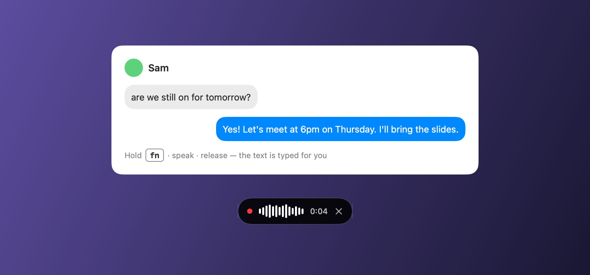
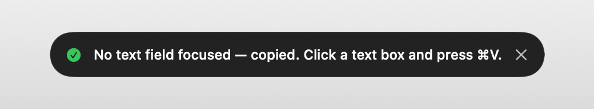
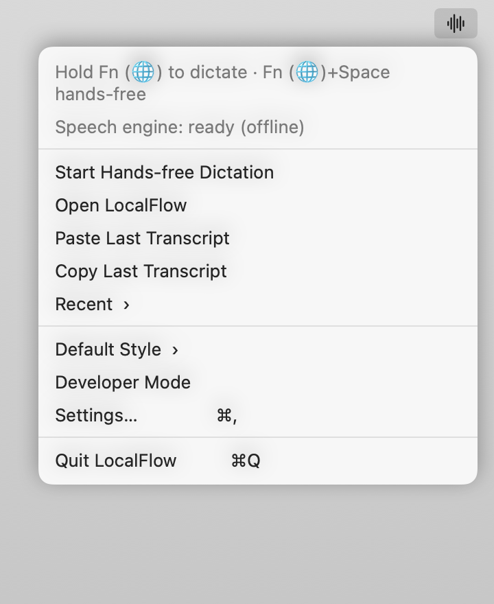
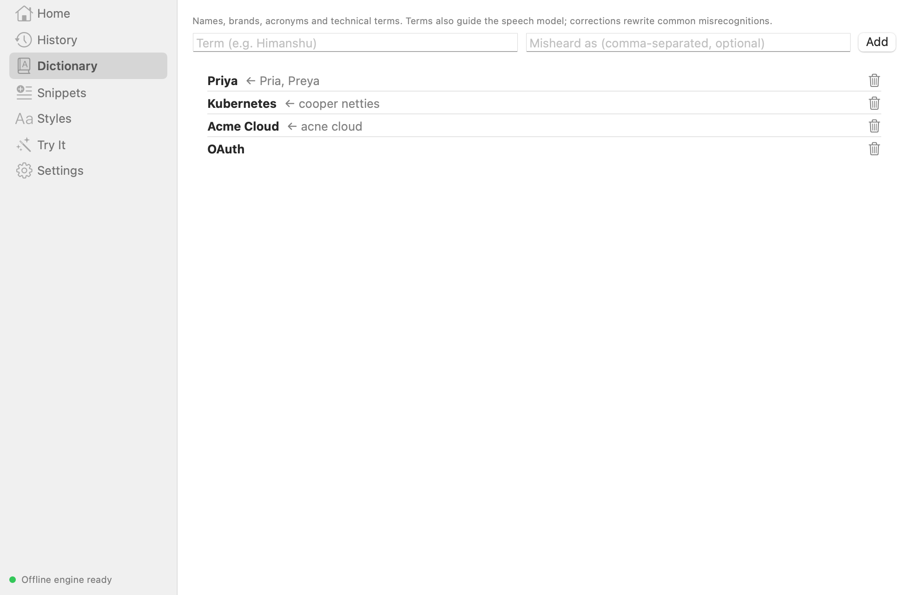
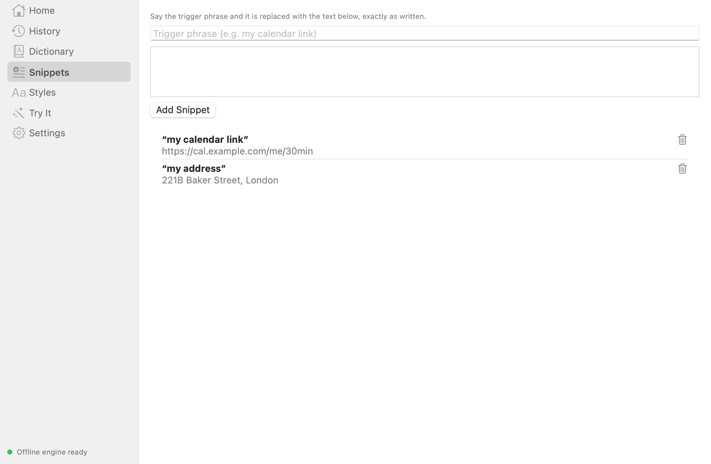
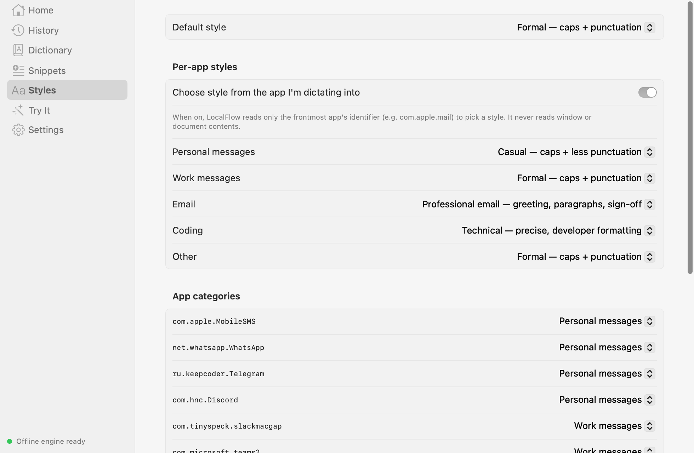
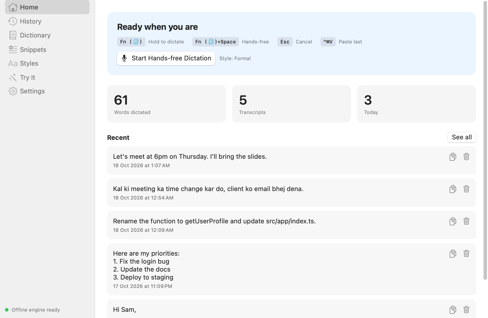
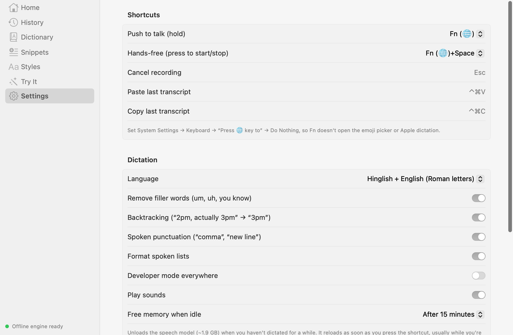

# LocalFlow

### Tired of paying for Wispr Flow? Try LocalFlow — free of cost, runs locally on your machine.

Hold a key, speak, let go — your words appear as clean, formatted text in whatever
app you're using. No subscription, no account, no cloud. Your voice never leaves your Mac.



- **Free and open source.** No subscription, no word limits.
- **100% local.** Speech recognition runs on your Mac with
  [whisper.cpp](https://github.com/ggml-org/whisper.cpp) and the Whisper
  `large-v3-turbo` model. Works offline, on a plane, anywhere.
- **Private by design.** No audio, text or usage data is ever sent anywhere.
- **Fast.** About 1–2 seconds from releasing the key to text on screen on Apple Silicon.
- **Speaks your language.** English, and Hindi/Hinglish typed in Roman letters
  (“kal meeting 6 baje rakhte hain”) — no Devanagari, no unwanted translation.

---

## How it works

### Hold Fn to talk

Hold **Fn (🌐)** anywhere you can type — WhatsApp, Slack, Mail, Notes, your browser,
your code editor. A small pill appears at the bottom of the screen with live levels
and a timer. Release the key and the text is typed into the app you were using.


### Fn + Space for hands-free

Press **Fn + Space** to start talking without holding anything — great for longer
messages. Press **Fn + Space** again (or **Fn**, or click **Finish**) when you're done.


### A second later, it's typed for you


The text is pasted into the focused app. When LocalFlow can confirm a text field took it,
your previous clipboard is restored; otherwise the transcript stays on the clipboard so
**⌘V** still works.
Changed your mind mid-recording? Press **Esc** to cancel.

### It never loses your words

No text box focused, or you're in a password field? LocalFlow copies the text
instead so you can paste it anywhere:



If a transcription ever fails, your audio is kept so you can retry without speaking again:


### Lives in your menu bar



| Action | Shortcut |
|---|---|
| Dictate (hold) | **Fn** |
| Hands-free start / stop | **Fn + Space** |
| Cancel recording | **Esc** |
| Paste last transcript | **⌃⌘V** |
| Copy last transcript | **⌃⌘C** |

---

## Smart formatting

LocalFlow cleans up the way people actually talk:

| You say | You get |
|---|---|
| “um, so, I think we should, you know, ship it today” | I think we should ship it today. |
| “let's meet at 2pm, no no, not 2pm, make it 6pm” | Let's meet at 6pm. |
| “let's connect tomorrow, no, day after tomorrow” | Let's connect day after tomorrow. |
| “my list is one milk two eggs three bread” | My list is:<br>1. Milk<br>2. Eggs<br>3. Bread |
| “hello comma how are you question mark” | Hello, how are you? |
| “bhai mujhe kuch samajh nahi aa raha” *(spoken in Hindi)* | Bhai, mujhe kuch samajh nahi aa raha. |

### Your words, spelled right — Dictionary

Add names, brands and jargon once. LocalFlow nudges recognition toward them and
fixes common mishearings.



### Snippets

Say a trigger phrase — “my calendar link” — and get the full text, exactly as written.



### Writing styles, per app

Formal, Casual, Very casual, Excited, Professional email (greeting, paragraphs,
sign-off) and Technical. Optionally pick a style automatically based on the app
you're dictating into — LocalFlow only looks at the app's name, never its contents.



### Developer mode

Dictate code-friendly text — and never worry about a command being run:

| You say | You get |
|---|---|
| “camel case get user profile” | `getUserProfile` |
| “snake case max retry count” | `max_retry_count` |
| “open src slash app slash index dot ts” | Open `src/app/index.ts`. |
| “npm install dash dash save dev” | `npm install --save dev` |
| “parse the jason from the api” | Parse the JSON from the API. |

LocalFlow only ever types text — it never presses Return, so a dictated shell
command is never executed.

### Your home base

Stats, recent transcripts and every setting in one place. Try formatting without
speaking in **Try It**.





---

## Install

Requirements: a Mac with **Apple Silicon**, **macOS 14+**, [Homebrew](https://brew.sh),
and the Xcode Command Line Tools (`xcode-select --install`). About 2 GB of free disk space.

```sh
git clone https://github.com/hdang2000/LocalFlow.git
cd LocalFlow
brew install whisper-cpp            # local speech engine
scripts/download-model.sh           # Whisper large-v3-turbo (~1.6 GB, checksum-verified)
scripts/make-signing-cert.sh        # optional: keeps macOS permissions across rebuilds
scripts/build-app.sh --install      # builds and installs ~/Applications/LocalFlow.app
open ~/Applications/LocalFlow.app
```

Then:

1. Allow **Accessibility** (System Settings → Privacy & Security → Accessibility) —
   needed for the global shortcut and for typing into other apps.
2. Allow the **Microphone** when asked.
3. Set System Settings → Keyboard → **“Press 🌐 key to” → Do Nothing**, so Fn
   doesn't open the emoji picker.
4. Hold **Fn** in any text field and start talking.

## Resource use

The speech model takes about **1.9 GB of memory** while loaded. CPU, GPU and battery
use are near zero when you're not dictating; each dictation is a 1–2 second burst on
the GPU. By default LocalFlow **frees that memory after 15 minutes without dictation**
and reloads it the moment you press the shortcut (usually before you've finished
speaking). Change it in Settings → *Free memory when idle*.

## Good to know

- Cleanup and styles are rule-based and run instantly on your Mac — they handle the
  common patterns, not every possible phrasing.
- Hindi is converted to Roman letters by rules plus a word list; uncommon words may
  be spelled slightly differently from how you'd type them.
- Your settings, dictionary and history are stored in
  `~/Library/Application Support/LocalFlow/`. History can be turned off.

## Develop

```sh
scripts/test.sh                                   # unit tests
swift build --scratch-path /tmp/localflow-build
/tmp/localflow-build/debug/LocalFlow --transcribe file.wav [--language hinglish] [--dev]
/tmp/localflow-build/debug/LocalFlow --render-screenshots docs/screenshots
```

- `Sources/LocalFlowCore` — settings and the text pipeline (snippets, corrections,
  developer formatting, fillers, punctuation, vocabulary, lists, styles, Hinglish).
- `Sources/LocalFlow` — the menu-bar app: global shortcuts, audio capture, the local
  whisper.cpp server, text insertion, the pill and the main window.

## License

[MIT](LICENSE)

*Wispr Flow is a trademark of its respective owner. LocalFlow is an independent
project and is not affiliated with or endorsed by Wispr.*
